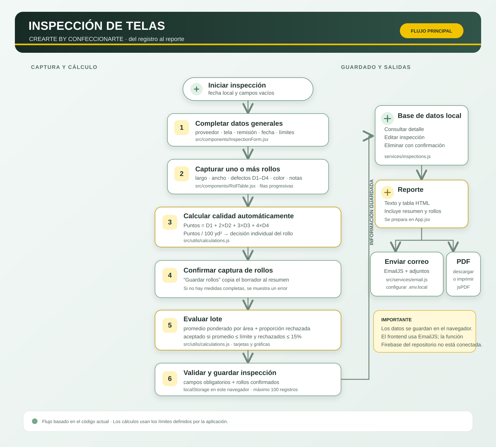

# INSPECCION_TELAS — CREARTE

## Instalación
1. Descomprime la carpeta.
2. Abre `inspeccion_telas` en Visual Studio Code.
3. En Terminal > Nueva terminal ejecuta:
   ```bash
   npm install
   npm run dev
   ```
4. Abre la URL que indique Vite (normalmente http://localhost:5173).

## Qué incluye esta primera versión
- Interfaz adaptable a computador y celular.
- Encabezado centrado con los criterios de calificación de defectos y huecos.
- Formulario editable con fecha local automática, proveedor, tela y remisión.
- Tabla de 30 rollos basada en la hoja `Auditoría Tela 4 puntos`.
- Registro de rollos disponible en un cuadro desplegable superpuesto con fondo desenfocado.
- Captura progresiva: inicia con un rollo visible y permite agregar filas según se necesiten; la gráfica incluye todos los rollos completos.
- Guardar rollos confirma la captura y actualiza el resumen y las gráficas de la pantalla principal; la inspección completa se conserva en Base de datos al guardar la inspección.
- Base de datos local de inspecciones con opciones para ver, editar y eliminar registros.
- Al iniciar, carga el historial local de inspecciones; el formulario comienza listo para una inspección nueva.
- Campanita con avisos de cambios pendientes, rollos rechazados y registros guardados; el botón de ayuda explica los flujos principales.
- Validación de datos obligatorios, rollos completos y formato de correo antes de guardar o preparar un correo.
- Número de rollo, largo, ancho útil y defectos editables; las capturas numéricas empiezan en cero.
- Cálculo ponderado de defectos: D1 + 2×D2 + 3×D3 + 4×D4.
- Fórmula por 100 yd² conservada de la fórmula Excel.
- Decisión por rollo y decisión de lote.
- Gráficos que se actualizan al completar rollos.
- Panel de envío de correo con el reporte completo en HTML dentro del mensaje y opción de adjuntar PDF e imagen.
- Cierre de inspección con descarga directa del reporte en PDF.

## Documentación del código

- [Guía técnica del código](./docs/guia-tecnica-del-codigo.md): explica la función de cada archivo y sus principales bloques, componentes y procesos.
- [Diagrama gráfico del flujo](./docs/diagrama-flujo-inspeccion.svg): vista visual del registro, cálculo, guardado y generación de reportes.



## Configurar el envío de correo con EmailJS
El correo se envía desde el navegador mediante EmailJS; la aplicación ya no llama a Firebase Cloud Functions ni requiere App Check, Firestore o secretos SMTP para esta función. El reporte de la inspección se incluye como HTML dentro del correo; adjuntar un PDF o imagen es opcional. El tamaño combinado de los adjuntos está limitado a 6 MB.

1. En EmailJS, configura un servicio de correo y una plantilla que use `to_email` como destinatario y `subject` como asunto. En el cuerpo HTML deja únicamente `{{{report_html}}}` (puedes conservar el diseño exterior de la plantilla). No agregues `{{{message}}}` ni otro saludo o despedida: la app incluye el saludo y mensaje antes del cuadro del reporte, y la despedida debajo. Las tres llaves permiten renderizar el HTML; los datos variables se escapan antes de enviarse.
2. El logo de Crearte está en `public/crearte-logo.png`. Después de desplegar Hosting, copia la URL pública del archivo y reemplaza el círculo con la letra “C” en la plantilla por una imagen, usando el dominio público real de la app:
   ```html
   
   ```
   No uses `localhost` en el `src`: los destinatarios no podrán acceder a tu computador.
3. Si quieres permitir adjuntos opcionales, en **Attachments** agrega archivos dinámicos de tipo **Form File Attachment** con los nombres de parámetro `report_pdf` y `report_image`.
4. En la configuración de seguridad de EmailJS, limita los dominios permitidos a los dominios donde publicarás la app y revisa sus cuotas y controles contra abuso. La clave pública del navegador no es un secreto.
5. Copia el Service ID, Template ID y Public Key de EmailJS en `.env.local`:
   ```dotenv
   VITE_EMAILJS_SERVICE_ID=service_id
   VITE_EMAILJS_TEMPLATE_ID=template_id
   VITE_EMAILJS_PUBLIC_KEY=public_key
   ```
6. Reinicia Vite después de cambiar `.env.local` y prueba con un destinatario que puedas revisar.

El envío depende de los límites y del plan vigente de EmailJS. Las variables dinámicas tienen un límite combinado de 50 KB según EmailJS; el reporte de inspección está diseñado para mantenerse por debajo de ese límite. No es necesario desplegar la función de correo de Firebase para esta versión. Si ya estaba desplegada, eliminarla en Firebase es una acción independiente; cambiar el código del frontend no la elimina automáticamente.

## Nota sobre la regla de lote
Se conservó la lógica de Excel: promedio de lote ≤ límite configurado y proporción de rollos rechazados ≤ 15%. Los valores iniciales son 40 para rollo y 28 para lote. Confirma con Calidad de CREARTE que estos límites siguen vigentes antes de usar el sistema para decisiones oficiales.
